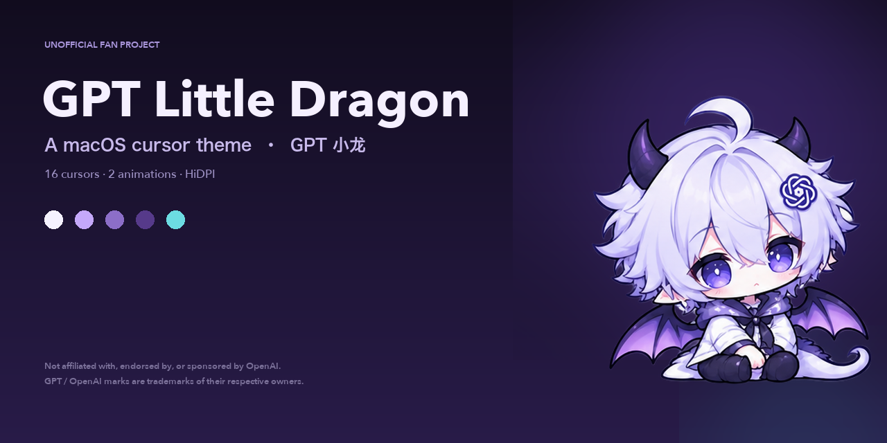

# GPT 小龙 · macOS 安装指南

> 写给第一次装自定义鼠标指针的人。照着做，大约 **3 分钟**。
> 适用：**macOS 13 Ventura 及以上** · Apple Silicon / Intel 都可以。



---

## 3 分钟速通

1. 安装 **MaCursor**
2. 下载 **`GPT-Little-Dragon-v16.cursor`**
3. 双击导入 → 选中主题 → 点 **Apply**
4. 安装 **Helper Tool**
5. **重置系统指针颜色**

> 第 4、5 步最容易漏。漏了会出现“重启就还原”或者“只有部分窗口生效”，不是主题坏了。

---

## 0. 先搞清楚这是什么

这不是一个 `.pkg` 安装包，不会自己装进系统。

它是一套 **MaCursor 专用的 `.cursor` 主题文件**：

- macOS 本身不能直接导入 `.cursor`
- 需要先装免费的 **MaCursor**
- 再由 MaCursor 把主题应用到系统指针

主题本身不会修改系统文件，随时可以一键恢复默认。

---

## 1. 你需要什么

| 项目 | 要求 |
|---|---|
| 系统 | macOS 13 Ventura 或更高 |
| 芯片 | Apple Silicon 或 Intel 都可以 |
| 软件 | [MaCursor](https://github.com/writronic/MaCursor/releases/latest)（免费） |
| 主题文件 | 约 1.7 MB 的 `.cursor` 文件 |

### 下载地址

| 要下载什么 | 说明 | 地址 |
|---|---|---|
| **主题文件（推荐）** | 只有主题，约 1.7 MB | [下载 `.cursor`](https://github.com/nanawakeinworld-cmd/GPT-Little-Dragon/raw/main/Cursor/GPT-Little-Dragon-v16.cursor) |
| **完整包** | 主题 + 文档 + 预览图 + 源码，约 12 MB | [Releases](https://github.com/nanawakeinworld-cmd/GPT-Little-Dragon/releases/latest) |
| **MaCursor** | 必需，免费、已公证 | [MaCursor Releases](https://github.com/writronic/MaCursor/releases/latest) |

> **下载小提示**
> - 只想要指针效果：下第一个 `.cursor` 就够了，不用解压。
> - 如果浏览器把文件存成了 `.cursor.txt`，把 `.txt` 删掉，恢复成 `.cursor`。
> - 完整包解压后，主题在 `GPT-Little-Dragon/Cursor/GPT-Little-Dragon-v16.cursor`。

---

## 2. 安装 MaCursor

1. 打开 [MaCursor Releases](https://github.com/writronic/MaCursor/releases/latest)。
2. 下载最新的 `.dmg`。
3. 打开 dmg，把 **MaCursor** 拖进 **应用程序（Applications）**。
4. 在“应用程序”里打开 MaCursor。

### 如果 macOS 提示“无法验证开发者”

MaCursor 的发行版由 Apple 签名并公证，正常不会出现。  
如果出现了：

1. 打开 `系统设置 → 隐私与安全性`
2. 在页面下方找到 MaCursor，点 **仍要打开**
3. 再启动一次

### 首次启动

MaCursor 会显示欢迎窗口，按提示走完即可。  
如果它请求权限（辅助功能、屏幕录制等），**只打开你需要的**；单纯换指针，通常只需要按它的引导完成 Helper Tool。

也可以用 Homebrew 安装：

```bash
brew install --cask writronic/tap/macursor
```

---

## 3. 导入主题

先确保 MaCursor 已经打开。然后任选一种：

### 方法 A：双击（最快）

双击 `GPT-Little-Dragon-v16.cursor`。

- 正常情况下会自动用 MaCursor 打开并导入。
- 如果双击没反应，或者被别的应用抢走：右键文件 → **打开方式** → **MaCursor**。

### 方法 B：拖进去

把 `.cursor` 文件直接拖进 MaCursor 主窗口。

### 方法 C：菜单导入

MaCursor 菜单 `File → Import Theme…`，选择该文件。

导入成功后，左侧主题列表会出现 **「GPT 小龙 v16」**。

> 如果你之前导入过同名主题，MaCursor 可能显示成 `GPT 小龙 v16-2`、`v16-3`。  
> 选**最新导入的那个**就行，旧的可以右键删除。

---

## 4. 应用主题

1. 在左侧列表选中刚导入的 **GPT 小龙 v16**。
2. 点右侧的 **Apply**。
3. 把鼠标移到桌面或 Finder 窗口上。

正常的话，指针会立刻变成紫色三角小龙箭头。

---

## 5. 安装 Helper Tool（强烈建议）

不装也能用，但**重启、休眠唤醒、切换用户后**，指针可能恢复成系统默认。

1. 打开 `MaCursor → Settings → General`。
2. 找到 **Helper Tool**。
3. 点 **Install**，按提示授权。

Helper 是一个很轻量的登录项，登录后会自动帮你重新应用主题。

装完后可以去 `系统设置 → 通用 → 登录项` 确认里面有 **MaCursorHelper**。

---

## 6. 重置系统指针颜色（最容易漏）

这一步非常关键，而且很多人不知道：

1. 打开 `系统设置 → 辅助功能 → 显示`。
2. 找到 **指针颜色**。
3. 点 **重置颜色**，恢复成默认的黑白指针。

### 为什么？

macOS 的“指针颜色”是一种辅助功能覆盖层。  
如果它被改成了彩色，自定义指针可能只在部分窗口生效，看起来就像“主题没装好”。

重置后，主题才会在全局正常显示。

---

## 7. 验证一下

把鼠标依次移到这些地方：

- [ ] 桌面：紫色三角箭头
- [ ] 文本输入框：笔记本电脑 + I-beam 小龙
- [ ] 拖拽文件：对应的拖拽指针
- [ ] 等待 / 忙碌状态：动画指针
- [ ] 重启后：仍然是主题样式
- [ ] 深色 / 浅色模式：边缘都清晰

都正常的话，就装好了。

---

## 8. 常见问题

| 现象 | 原因 | 怎么办 |
|---|---|---|
| 双击 `.cursor` 没反应 | 文件没有关联到 MaCursor | 右键 → 打开方式 → MaCursor |
| 导入了但指针没变 | 没点 Apply | 选中主题，点 **Apply** |
| 只有部分窗口生效 | 系统指针颜色被改过 | 辅助功能 → 显示 → **重置颜色** |
| 重启后恢复默认 | 没装 Helper Tool | 设置 → General → 安装 Helper |
| 切换用户后恢复默认 | Helper 没运行 | 重新登录，检查登录项 |
| 终端 / Adobe / 游戏里无效 | 应用自己绘制光标 | 无法修复，属于 macOS 限制 |
| 指针边缘模糊 | 屏幕缩放 / 外接非 Retina 屏 | 主题已含 2× 图；检查 MaCursor 缩放设置 |
| 指针太大 / 太小 | 缩放比例不合适 | 用 MaCursor 的指针缩放滑块 |
| 动画不动 | 当前指针角色没有动画 | 只有 Wait / 忙碌角色有动画 |
| 导入失败 / 文件损坏 | 下载不完整或系统太旧 | 重新下载；确认 macOS 13+ |
| 提示“无法验证开发者” | 系统安全策略 | 隐私与安全性 → 仍要打开 |

更详细的排查见 [`Troubleshooting.md`](Troubleshooting.md)。

---

## 9. 卸载 / 恢复默认

### 只想恢复默认指针

MaCursor 菜单 `File → Reset System Cursor`，立刻恢复。

### 删除这个主题

在 MaCursor 里右键主题 → 删除。

### 彻底卸载 MaCursor

1. 先执行 `File → Reset System Cursor`
2. 退出 MaCursor
3. 删除 `/Applications/MaCursor.app`
4. 删除 `~/Library/Application Support/MaCursor`
5. 在 `系统设置 → 通用 → 登录项` 里移除 MaCursorHelper

详细步骤见 [`Uninstall.md`](Uninstall.md)。

---

## 10. 以后怎么更新主题

1. 下载新版 `.cursor`
2. 导入 MaCursor
3. 选中新版本 → **Apply**
4. 确认没问题后，删除旧版本

主题更新不会影响你的其他设置。

---

## 11. 已知限制

以下应用会自己绘制光标，主题覆盖不了：

- 终端（Terminal / iTerm2 的文本光标）
- Adobe 系列
- 大多数游戏
- 部分 Electron 应用

这是 macOS 的机制限制，不是安装失败，也不是主题的问题。

---

## 12. 授权与声明

- 免费分享，**禁止商业使用**
- 美术素材：CC BY-NC-SA 4.0
- 代码：MIT
- **非 OpenAI 官方作品**，与 OpenAI 无隶属关系
- “GPT”“OpenAI”及 OpenAI 标志是其权利人的商标
- 请勿售卖，也请勿暗示官方授权

完整说明见仓库根目录的 [`LICENSE`](../LICENSE) 和 [`Credits/Credits.md`](../Credits/Credits.md)。

---

## 13. 还是搞不定？

可以在仓库开 issue，或者私信我。  
发问题时带上这些信息，会快很多：

- macOS 版本（ `  → 关于本机`）
- 芯片（Apple Silicon / Intel）
- MaCursor 版本
- 卡在哪一步
- 截图（注意打码个人信息）

---

## 附：可以直接复制发给朋友

```
GPT 小龙 macOS 指针主题（免费，非商业）

1. 先装 MaCursor：
   https://github.com/writronic/MaCursor/releases/latest

2. 下载主题：
   https://github.com/nanawakeinworld-cmd/GPT-Little-Dragon/raw/main/Cursor/GPT-Little-Dragon-v16.cursor

3. 双击导入 → 选中 GPT 小龙 v16 → 点 Apply

4. 一定要做：
   - MaCursor 设置里安装 Helper Tool
   - 系统设置 → 辅助功能 → 显示 → 指针颜色 → 重置颜色

非官方粉丝作品，与 OpenAI 无关。
```
