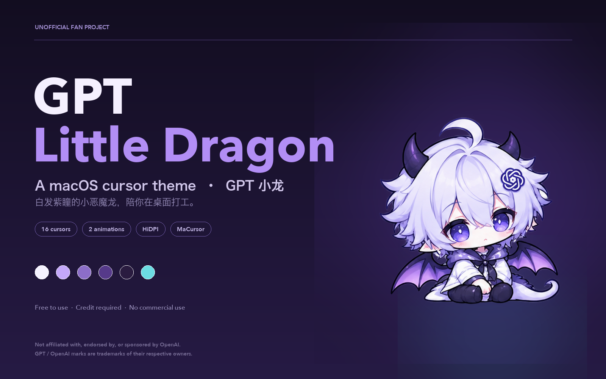
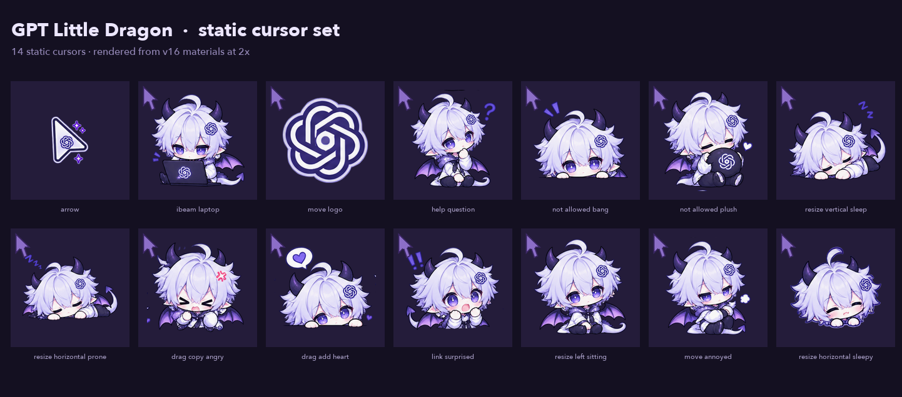
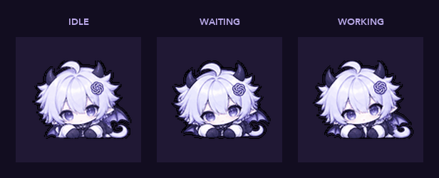
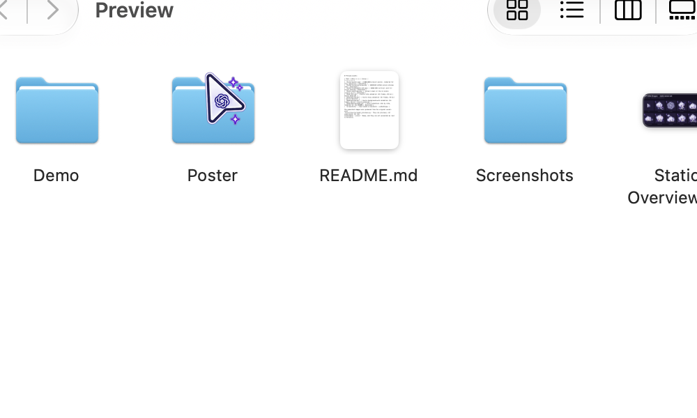
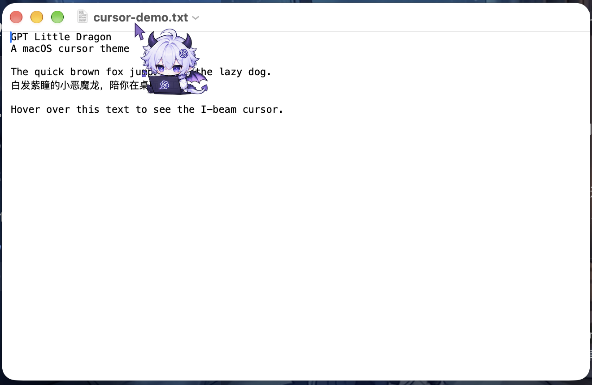
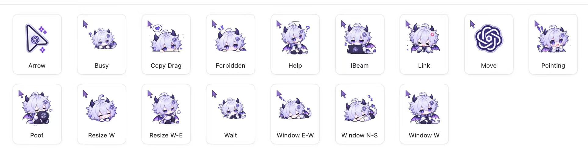

<div align="center">



# GPT Little Dragon

**A macOS cursor theme · GPT 小龙**

[English](#english) · [简体中文](#简体中文)


</div>

> [!WARNING]
> **Unofficial fan project.** This theme is a personal, non-commercial fan work.
> It is **not affiliated with, endorsed by, or sponsored by OpenAI**.
> “GPT”, “OpenAI” and the OpenAI knot logo are trademarks of OpenAI.
> The character and its accessories merely reference the GPT ecosystem as a fan tribute.
> If you are a rights holder and want something changed or removed, please open an issue.

---

## English

### What is this?

A free macOS cursor theme starring **GPT Little Dragon** — a chibi white-haired, purple-eyed
little dragon with small demon horns and bat wings. The set replaces the system pointer with
16 hand-tuned cursors: one purple arrow, thirteen character states, and two animations.

The theme is packaged as a `.cursor` file for [MaCursor](https://github.com/writronic/MaCursor),
a free and notarized cursor manager for macOS.

**Status:** `v16` is built and structurally validated, and was applied successfully in
**MaCursor 2.8.0 on macOS 27.2 (Apple Silicon)**. Real screenshots are included.
A clean-install test and macOS 13/14/15 testing are still pending. See
[Status & roadmap](#status--roadmap).

### Preview

| Poster | Static set |
|---|---|
|  |  |



| Finder | Text editor | Full cursor set |
|---|---|---|
|  |  |  |

> The GIF is rendered from the source animation files. The Finder and TextEdit images are
> real captures taken on macOS 27.2 with the theme applied; the cursor is the real system
> cursor, not composited. The third image is the complete 16-cursor set as displayed by MaCursor.

### Character & design

- **Palette:** moonlight white, lavender, deep violet, with a cyan accent.
- **Silhouette:** oversized head, small horns, bat wings, soft tail — readable even at 32 px.
- **Click indicator:** every character cursor carries a small purple arrow in the top-left
  corner (26% of the canvas), so you always know where the actual click point is.
- **HiDPI:** each cursor ships with 1× and 2× representations for Retina displays.
- **Consistency:** all static cursors use the same 92 pt canvas and 88% character fill;
  the main arrow is 50 pt, animations are 80 pt.

### What's inside

| Group | Count | Notes |
|---|---:|---|
| Main arrow | 1 | Purple triangle pointer, 50 pt, hotspot at the tip |
| Static character cursors | 13 | 92 pt, one per macOS cursor role |
| Animated cursors | 2 | `Wait` (7 frames) and busy (8 frames), 200 ms/frame |
| **Total** | **16** | packaged as one `.cursor` theme |

**Animated states**

| State | Source | Frames | Frame time | Wired into v16? |
|---|---|---:|---:|---|
| Idle (breathing, blinking, tail sway) | `01_普通待机_小龙.gif` | 16 | 60 ms | No — see note below |
| Waiting (busy) | `02_忙碌等待_小龙.gif` | 7 used | 200 ms | Yes (`com.apple.coregraphics.Wait`) |
| Working (background task) | `03_后台工作_小龙.gif` | 8 used | 200 ms | Yes (`com.apple.cursor.4`) |

The idle animation is included in `Cursor/Animated/Idle/` as source material. macOS has no
persistent “idle” cursor role that animates while the pointer rests — the arrow is static — so
Idle is kept as a preview/future asset rather than mapped into `v16`. The two states macOS can
animate (`Wait` and busy) are both wired in.

**Static roles**

| File | macOS role | Design |
|---|---|---|
| `arrow.png` | Normal pointer | Purple triangle with a GPT knot |
| `ibeam-laptop.png` | Text / I-beam | Dragon typing on a laptop |
| `move-logo.png` | Move | GPT knot cross |
| `help-question.png` | Help | Dragon with a “?” |
| `not-allowed-bang.png` | Not allowed | Startled dragon with “!” |
| `not-allowed-plush.png` | Not allowed (alt) | Dragon hugging a plush |
| `resize-vertical-sleep.png` | Vertical resize | Sleeping dragon with “zzz” |
| `resize-horizontal-prone.png` | Horizontal resize | Dragon lying prone |
| `drag-copy-angry.png` | Drag copy | Grumpy dragon |
| `drag-add-heart.png` | Drag add / alias | Dragon with a heart |
| `link-surprised.png` | Link | Surprised dragon |
| `resize-left-sitting.png` | Resize (left) | Sitting dragon |
| `move-annoyed.png` | Move (alt) | Annoyed dragon |
| `resize-horizontal-sleepy.png` | Resize (alt) | Sleepy dragon |

### Compatibility

- **macOS 13 Ventura or later** — required by MaCursor.
- **Apple Silicon and Intel** — MaCursor ships a universal binary.
- **MaCursor is required.** The theme is a MaCursor `.cursor` package; macOS cannot import it
  by itself.
- Some apps draw their own cursors and cannot be themed: Terminal, Adobe apps, most games,
  and some Electron apps.
- macOS 26 Tahoe / 27: MaCursor advertises support, but this theme has **not** been verified there.

### Install

1. **Install MaCursor** — download the latest `.dmg` from
   [MaCursor Releases](https://github.com/writronic/MaCursor/releases/latest), open it, and drag
   MaCursor into `/Applications`. The app is code-signed and notarized by Apple.
2. **Import the theme** — double-click `Cursor/GPT-Little-Dragon-v16.cursor`, or drag it onto
   the MaCursor window, or use `File → Import Theme…`.
3. **Apply** — select “GPT 小龙 v16” in the left sidebar and click **Apply**.
4. **Install the Helper Tool** — `MaCursor → Settings → General → Helper Tool → Install`.
   Without it, cursors reset after a reboot or a user switch.
5. **Reset the system pointer colour** — `System Settings → Accessibility → Display →
   Pointer colour → Reset colour`. Without this step the theme may only apply in some windows.

Full step-by-step guide, including screenshots to be added later:
[`Installation/Install.md`](Installation/Install.md).

### Uninstall / restore

- **Restore the default cursor:** in MaCursor choose `File → Reset System Cursor`.
- **Remove the theme:** right-click the theme in MaCursor and delete it.
- **Remove MaCursor completely:** quit the app, delete `/Applications/MaCursor.app`, then remove
  `~/Library/Application Support/MaCursor` and the MaCursor login item in
  `System Settings → General → Login Items`.
- **If something looks stuck:** log out and back in, or reboot.

Details: [`Installation/Uninstall.md`](Installation/Uninstall.md).

### FAQ

**Is it free?**
Yes. Personal, non-commercial use is free, and modification is allowed under CC BY-NC-SA 4.0
with attribution and share-alike.

**Can I sell it or use it in a commercial product?**
No. The artwork is licensed **NonCommercial**. See [`LICENSE`](LICENSE).

**Can I make my own version?**
Yes — keep the credit, mark your changes, and release your version under the same
CC BY-NC-SA 4.0 license. Do not imply it is official.

**Does it work on Windows or Linux?**
No. This is a MaCursor `.cursor` theme for macOS only. The PNG/GIF assets could be converted
for other platforms, but that conversion is not included.

**Do I need an OpenAI account?**
No. The theme is purely cosmetic and has no connection to any OpenAI service.

**Why “GPT”?**
Because the character is a fan tribute to the GPT ecosystem. It is not an official OpenAI
product or mascot.

**Will it slow down my Mac?**
No. It is a set of static images and two small animations loaded by MaCursor.

**The cursor is too big / too small.**
Use MaCursor's cursor scale slider (0.50×–4.00×). To change the baked-in sizes, edit
`P_ARROW`, `P_CHAR`, `P_ANIM` in [`Cursor/Source/build_theme.py`](Cursor/Source/build_theme.py)
and rebuild.

**Why does the theme reset after a reboot?**
Install the MaCursor Helper Tool. That is the intended fix.

### Assets, AI assistance & licensing

- **Character art:** AI-assisted original artwork, provided by the project author. The character
  design, poses and animation frames were produced with generative AI tools and then curated.
  The exact tools and prompts were **not recorded**; this gap is disclosed in
  [`Credits/Credits.md`](Credits/Credits.md).
- **OpenAI logo:** the GPT knot appears on hair clips, a laptop, a plush, the arrow and the move
  cursor. It is used as a fan reference only. **No trademark licence is granted**, and this
  project does not claim any rights in the OpenAI marks.
- **Code:** the build and preview scripts are MIT-licensed — see [`LICENSE-CODE`](LICENSE-CODE).
- **Artwork:** the cursor images, GIFs and poster are CC BY-NC-SA 4.0 — see [`LICENSE-ARTWORK`](LICENSE-ARTWORK).
- **Fonts:** no third-party font files are bundled. Preview images were rendered with system
  fonts.
- **Redistribution caveat:** because the artwork incorporates the OpenAI logo, redistribution
  may carry trademark risk even though the copyright licence permits non-commercial sharing.
  Do not sell it, and do not present it as official.

Attribution template:

```
GPT Little Dragon — macOS cursor theme
by <author> — <repository URL>
Licensed under CC BY-NC-SA 4.0. Changes were made.
Unofficial fan work; not affiliated with OpenAI.
```

### Credits

- [MaCursor](https://github.com/writronic/MaCursor) by Writronic — cursor engine and `.cursor`
  format support.
- [Mousecape](https://github.com/alexzielenski/Mousecape) — prior art and inspiration for macOS
  cursor theming.
- OpenAI — owner of the GPT/OpenAI marks referenced by this fan work. No affiliation.
- The generative AI tools used to create and refine the character art. Their exact
  names and versions were not recorded; see [`Credits/Credits.md`](Credits/Credits.md).

### Status & roadmap

- [x] 16 cursors packaged into a `.cursor` theme
- [x] 1× / 2× HiDPI representations
- [x] Structural validation (16 cursors, frame sheets, hotspots, alpha)
- [x] Repository structure, README, licence drafts, install docs
- [x] Re-ran the archived builder: 14 static cursors byte-identical, 2 animated cursors slightly different
- [x] Applied in MaCursor 2.8.0 on macOS 27.2; real screenshots captured
- [x] Licence posture: fan use, non-commercial, logo kept with a clear disclaimer
- [x] Idle kept as a source-only preview (no macOS idle cursor role)
- [ ] Reconcile the animated GIF revision
- [ ] Test on a clean macOS 13/14/15 machine
- [ ] Verify on macOS 26 Tahoe / 27
- [x] Add real screenshots (`Preview/Screenshots/`)
- [ ] Freeze a downloadable release and checksum

### Repository layout

```
GPT-Little-Dragon/
├── README.md
├── LICENSE
├── LICENSE-CODE
├── LICENSE-ARTWORK
├── CHANGELOG.md
├── .gitignore
├── Preview/
│   ├── Poster/            # poster, social-preview, xiaohongshu-4x5
│   ├── Static-Overview.png
│   ├── Screenshots/          # real captures
│   └── Demo/                 # idle / waiting / working + montage
├── Cursor/
│   ├── GPT-Little-Dragon-v16.cursor
│   ├── Animated/{Idle,Waiting,Working}/
│   ├── Static/               # 14 rendered 2× previews
│   └── Source/               # original crops, sheet, GIFs, build scripts
├── Installation/
│   ├── Install.md
│   ├── Uninstall.md
│   └── Troubleshooting.md
└── Credits/Credits.md
```

---

## 简体中文

### 这是什么

一套免费的 macOS 鼠标指针主题，主角是 **GPT 小龙**——白发紫瞳、带小恶魔角和蝙蝠翅膀的
Q 版小龙。主题把系统指针替换成 16 个精心调整过的指针：1 个紫色箭头、13 个角色静态状态、
2 个动画状态。

主题打包为 [MaCursor](https://github.com/writronic/MaCursor) 使用的 `.cursor` 文件。
MaCursor 是一款免费、已公证的 macOS 指针管理工具。

**当前状态：** `v16` 已生成并通过结构校验，并在 **macOS 27.2（Apple Silicon）+ MaCursor 2.8.0**
上成功应用，附真实截图。干净系统与 macOS 13/14/15 的测试仍待补。详见
[状态与路线图](#状态与路线图)。

### 预览

| 海报 | 静态指针总览 |
|---|---|
|  |  |


| Finder | 文本编辑器 | 全套指针 |
|---|---|---|
|  |  |  |

> 上面的 GIF 是用源动画文件渲染的预览，实际显示可能略有差异。Finder 和 TextEdit 两张是在
> macOS 27.2 上应用主题后实拍的，指针是真实系统指针，没有合成；第三张是 MaCursor 里的
> 全套 16 个指针总览。

### 角色与设计

- **配色：** 月光白、薰衣草紫、深紫，点缀一点青色。
- **剪影：** 大头、小角、蝙蝠翅膀、软尾巴，缩到 32 px 仍然能认出来。
- **点击提示：** 每个角色指针左上角都带一个紫色小箭头（占画布 26%），
  一眼就能看出真正的点击位置。
- **HiDPI：** 每个指针都带 1× 和 2× 两套图，Retina 屏上不糊。
- **统一规格：** 静态角色统一 92 pt 画布、角色占 88%；主箭头 50 pt；动画 80 pt。

### 包含什么

| 分组 | 数量 | 说明 |
|---|---:|---|
| 主箭头 | 1 | 紫色三角指针，50 pt，热点在尖端 |
| 静态角色指针 | 13 | 92 pt，对应不同的 macOS 指针角色 |
| 动画指针 | 2 | `Wait`（7 帧）与忙碌（8 帧），200 ms/帧 |
| **合计** | **16** | 打包为一个 `.cursor` 主题 |

**动画状态**

| 状态 | 源文件 | 帧数 | 帧时长 | v16 是否接入 |
|---|---|---:|---:|---|
| 待机（呼吸、眨眼、尾巴轻摆） | `01_普通待机_小龙.gif` | 16 | 60 ms | 否——见下方说明 |
| 忙碌等待 | `02_忙碌等待_小龙.gif` | 用 7 帧 | 200 ms | 是（`com.apple.coregraphics.Wait`） |
| 后台工作 | `03_后台工作_小龙.gif` | 用 8 帧 | 200 ms | 是（`com.apple.cursor.4`） |

待机动画已放在 `Cursor/Animated/Idle/`。macOS 没有“指针停着时持续播放”的待机指针角色——
普通箭头是静态的——所以 Idle 作为预览/未来素材保留，没有映射进 `v16`。
macOS 真正能动画的两个状态（`Wait` 和忙碌）都已接入。

**静态角色一览**

| 文件 | macOS 角色 | 设计 |
|---|---|---|
| `arrow.png` | 普通指针 | 带 GPT 结的紫色三角 |
| `ibeam-laptop.png` | 文本 / I-beam | 小龙敲笔记本 |
| `move-logo.png` | 移动 | GPT 结十字 |
| `help-question.png` | 帮助 | 小龙和“？” |
| `not-allowed-bang.png` | 禁止 | 惊讶小龙和“！” |
| `not-allowed-plush.png` | 禁止（变体） | 小龙抱玩偶 |
| `resize-vertical-sleep.png` | 垂直调整 | 趴睡小龙和“zzz” |
| `resize-horizontal-prone.png` | 水平调整 | 趴着的小龙 |
| `drag-copy-angry.png` | 拖拽拷贝 | 生气的小龙 |
| `drag-add-heart.png` | 拖拽添加 / 替身 | 带爱心的小龙 |
| `link-surprised.png` | 链接 | 惊讶的小龙 |
| `resize-left-sitting.png` | 调整（左） | 坐姿小龙 |
| `move-annoyed.png` | 移动（变体） | 不爽的小龙 |
| `resize-horizontal-sleepy.png` | 调整（变体） | 瞌睡的小龙 |

### 适用范围

- **macOS 13 Ventura 或更高版本**——MaCursor 的最低要求。
- **Apple Silicon 与 Intel 都支持**——MaCursor 是通用二进制。
- **必须安装 MaCursor**：这是 MaCursor 的 `.cursor` 包，macOS 本身不能直接导入。
- 终端、Adobe 系、大多数游戏和部分 Electron 应用会自绘光标，无法被主题覆盖。
- macOS 26 Tahoe / 27：MaCursor 宣称支持，但本主题**尚未**在这些系统上验证。

### 安装

1. **安装 MaCursor**——从 [MaCursor Releases](https://github.com/writronic/MaCursor/releases/latest)
   下载最新 `.dmg`，打开后把 MaCursor 拖进 `/Applications`。应用已签名并公证。
2. **导入主题**——双击 `Cursor/GPT-Little-Dragon-v16.cursor`，或拖进 MaCursor 窗口，
   或使用菜单 `File → Import Theme…`。
3. **应用**——在左侧选中「GPT 小龙 v16」，点 **Apply**。
4. **安装 Helper Tool**——`MaCursor → Settings → General → Helper Tool → Install`。
   不装的话，重启或切换用户后指针会还原。
5. **重置系统指针颜色**——`系统设置 → 辅助功能 → 显示 → 指针颜色 → 重置颜色`。
   不改的话，自定义指针可能只在部分窗口生效。

完整步骤见 [`Installation/Install.md`](Installation/Install.md)。

### 卸载与恢复

- **恢复默认指针：** MaCursor 菜单 `File → Reset System Cursor`。
- **删除主题：** 在 MaCursor 里右键主题 → 删除。
- **彻底移除 MaCursor：** 退出应用，删除 `/Applications/MaCursor.app`，再删除
  `~/Library/Application Support/MaCursor`，以及在
  `系统设置 → 通用 → 登录项` 里移除 MaCursor 的登录项。
- **如果指针卡住：** 注销后重新登录，或重启。

详见 [`Installation/Uninstall.md`](Installation/Uninstall.md)。

### 常见问题

**免费吗？**
免费。个人非商业使用免费；在 CC BY-NC-SA 4.0 下允许修改，但需要署名并以相同协议分享。

**可以拿去卖或用在商业产品里吗？**
不可以。美术素材是 **非商业**（NonCommercial）授权。见 [`LICENSE`](LICENSE)。

**可以自己做改版吗？**
可以——保留署名、标注改动，并用同样的 CC BY-NC-SA 4.0 协议发布。
不要暗示你的版本是官方版本。

**Windows / Linux 能用吗？**
不能。这是 macOS 专用的 MaCursor `.cursor` 主题。PNG/GIF 素材理论上可以转换到其他平台，
但本项目不包含转换步骤。

**需要 OpenAI 账号吗？**
不需要。主题纯装饰，不连接任何 OpenAI 服务。

**为什么叫“GPT”？**
因为角色是对 GPT 生态的粉丝致敬，不是 OpenAI 的官方产品或吉祥物。

**会拖慢 Mac 吗？**
不会。它只是一组静态图和两个很小的动画，由 MaCursor 加载。

**指针太大 / 太小？**
用 MaCursor 的指针缩放滑块（0.50×–4.00×）。想改烘焙进主题的尺寸，改
[`Cursor/Source/build_theme.py`](Cursor/Source/build_theme.py) 里的
`P_ARROW`、`P_CHAR`、`P_ANIM` 后重新构建。

**为什么重启后主题会还原？**
装 MaCursor 的 Helper Tool，这是官方推荐的修复方式。

### 素材、AI 辅助与授权

- **角色美术：** 由项目作者提供的 AI 辅助原创美术。角色设计、姿势和动画帧由生成式 AI
  工具产出后经人工筛选整理。具体工具与提示词**没有留存记录**，这一点已在
  [`Credits/Credits.md`](Credits/Credits.md) 中如实说明。
- **OpenAI 标志：** GPT 结出现在发夹、笔记本、玩偶、箭头和移动指针上，仅作为粉丝参照。
  **不授予任何商标许可**，本项目也不主张 OpenAI 商标的任何权利。
- **代码：** 构建与预览脚本使用 MIT 协议，见 [`LICENSE-CODE`](LICENSE-CODE)。
- **美术素材：** 指针图片、GIF 和海报使用 CC BY-NC-SA 4.0，见 [`LICENSE-ARTWORK`](LICENSE-ARTWORK)。
- **字体：** 仓库不包含第三方字体文件；预览图使用系统字体渲染。
- **再分发提醒：** 因为素材包含 OpenAI 标志，即使版权协议允许非商业分享，
  再分发仍可能涉及商标风险。不要售卖，也不要冒充官方。

署名模板：

```
GPT Little Dragon — macOS cursor theme
作者：<作者名> — <仓库地址>
Licensed under CC BY-NC-SA 4.0. Changes were made.
Unofficial fan work; not affiliated with OpenAI.
```

### 致谢

- [MaCursor](https://github.com/writronic/MaCursor)（Writronic）——指针引擎与 `.cursor` 格式支持。
- [Mousecape](https://github.com/alexzielenski/Mousecape)——macOS 指针主题化的先行项目与灵感来源。
- OpenAI——本粉丝作品所引用 GPT/OpenAI 标志的权利人。无隶属关系。
- 用于生成与打磨角色美术的生成式 AI 工具；具体工具名与版本没有留存记录，见
  [`Credits/Credits.md`](Credits/Credits.md)。

### 状态与路线图

- [x] 16 个指针打包为 `.cursor` 主题
- [x] 1× / 2× HiDPI 表示
- [x] 结构校验（16 个指针、帧图尺寸、热点、透明通道）
- [x] 仓库结构、README、许可证草案、安装文档
- [x] 重跑归档构建脚本：14 个静态指针逐字节一致，2 个动画指针略有差异
- [x] 在 macOS 27.2 + MaCursor 2.8.0 上成功应用，并完成实拍截图
- [x] 授权口径：粉丝非商业使用，保留标志并明确免责
- [x] 待机动画作为源素材预览保留（macOS 没有待机指针角色）
- [ ] 核对动画 GIF 的版本
- [ ] 在干净的 macOS 13/14/15 机器上实测
- [ ] 在 macOS 26 Tahoe / 27 上验证
- [x] 补真实截图（`Preview/Screenshots/`）
- [ ] 冻结可下载的 Release 并生成校验和

### 仓库结构

```
GPT-Little-Dragon/
├── README.md
├── LICENSE
├── LICENSE-CODE
├── LICENSE-ARTWORK
├── CHANGELOG.md
├── .gitignore
├── Preview/
│   ├── Poster/            # poster, social-preview, xiaohongshu-4x5
│   ├── Static-Overview.png
│   ├── Screenshots/          # 实拍截图
│   └── Demo/                 # idle / waiting / working + 拼图
├── Cursor/
│   ├── GPT-Little-Dragon-v16.cursor
│   ├── Animated/{Idle,Waiting,Working}/
│   ├── Static/               # 14 个 2× 渲染预览
│   └── Source/               # 原始裁切图、拼图、GIF、构建脚本
├── Installation/
│   ├── Install.md
│   ├── Uninstall.md
│   └── Troubleshooting.md
└── Credits/Credits.md
```
